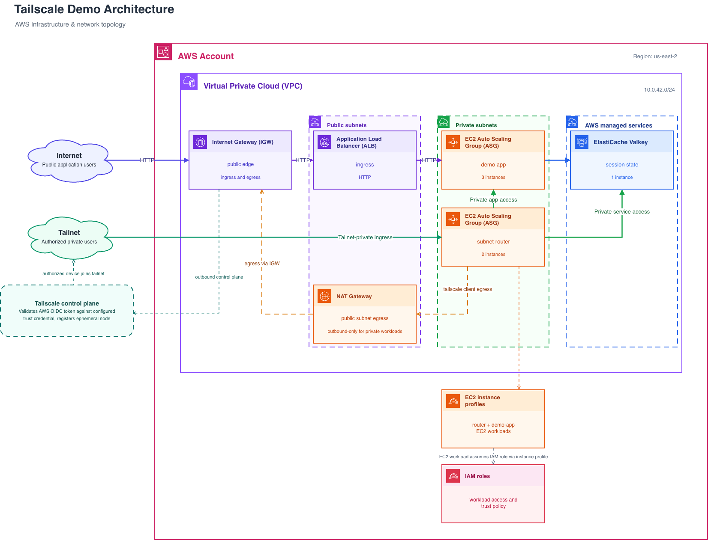
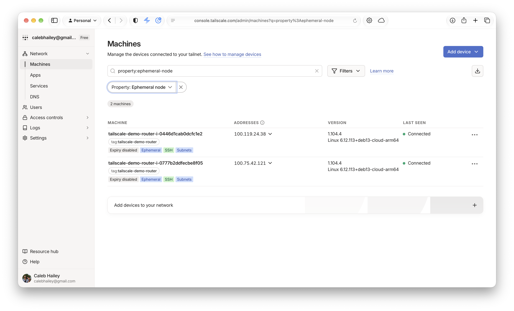
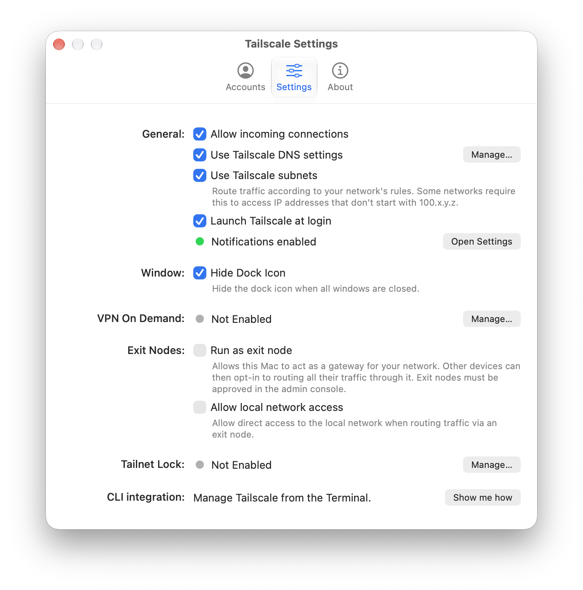
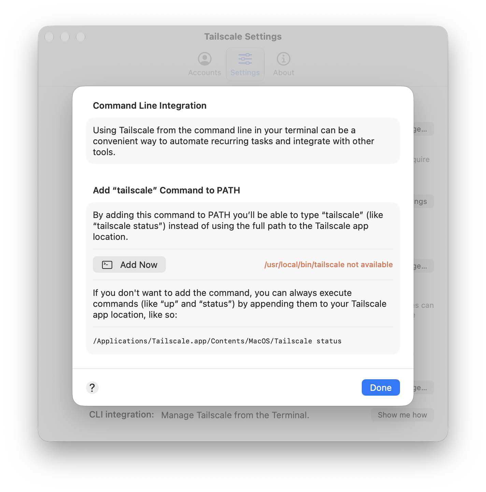
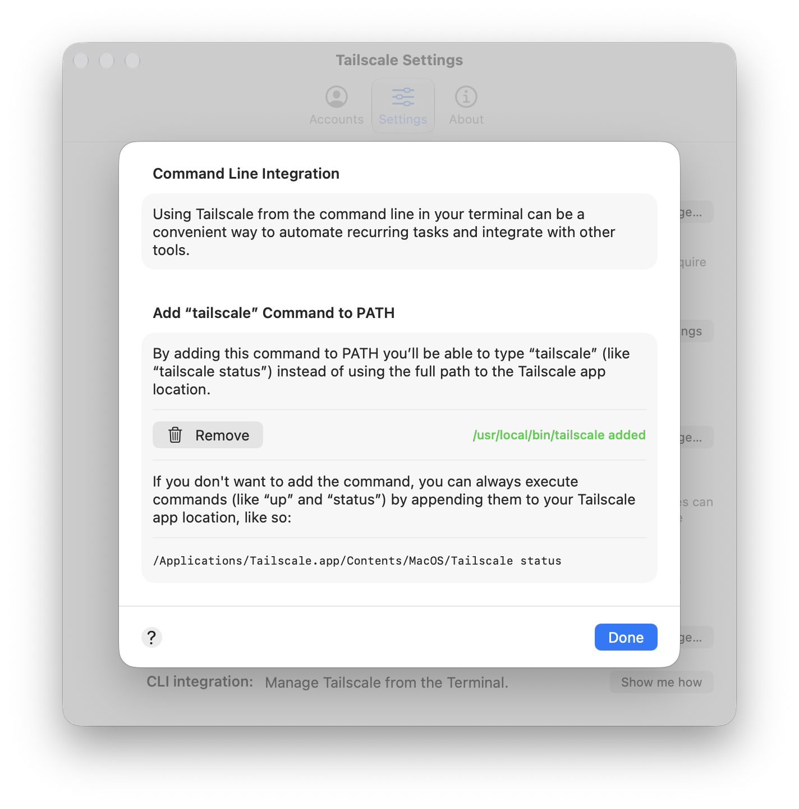

# Tailscale Demo

* [Overview](#overview)
* [Demo](#demo)
* [Prerequisites](#prerequisites)
  * [Workstation](#workstation)
  * [Tailscale Account](#tailscale-account)
  * [AWS Account](#aws-account)
  * [Identity Federation](#identity-federation)
* [Setup](#setup)
  * [Packer](#packer)
  * [Terraform](#terraform)
* [Local Development](#local-development)
  * [Demo app](#demo-app)
  * [Local VMs](#local-vms)
* [Plan](#roadmap)

## Overview

This demo highlights the value proposition of the Tailscale platform, specifically including [Tailscale Subnet Routers].
The demo will focus on how Tailscale Subnet Routers facilitate ["gradual deployment"] of Tailscale in hybrid cloud infrastructures, as well as the ["managed services access"] use case.



## Demo

To prepare for this demo, please follow the instructions in [Prerequisites](#prerequisites), [Packer](#packer) setup, and [Terraform](#terraform) setup.
Once the infrastructure is deployed and you can `GET /api/healthz`, you're ready to proceed with the demo.

1.  **Start with the Tailscale Console**

    The demo should start with two dedicated Tailscale Subnet Routers for access to a legacy application (with no Tailscale client) and a managed infrastructure service (ElastiCache Valkey).

    Open the Tailscale Console → Machines view, and select Filters → Property → Ephemeral node.
    Only the two Subnet routers should be present.

    

    > **Tailscale Identity Federation**
    >
    > This demo uses [Tailscale Identity Federation] instead of auth keys to authenticate ephemeral Tailscale clients.
    > Identity Federation is possible by establishing a trust relationship between Tailscale and various third-party systems such as Amazon Web Services.
    > See [Identity Federation](#identity-federation) for more information on how this works.

    _NOTE: no application nodes should be present until we proceed with the app v2 deployment._

1.  **Connect to the Tailscale demo app**

    The application and HTTP API should be reachable through the AWS ALB.

    ```shell
    APP_URL=$(terraform -chdir=terraform output -raw app_url)
    curl -i "${APP_URL}/api/healthz"
    curl --fail "${APP_URL}/api/readyz"
    ```

    **Refreshing the web app to exercise the ALB and ElastiCache Valkey session state implementation.**
    The demo app is served from three EC2 instances in an AWS ASG, behind an ALB with round-robin selection enabled and sticky sessions disabled.
    The demo app relies on ElastiCache Valkey for session state so sessions persist regardless of which app instance serves the request.

    ```shell
    open "${APP_URL}"
    ```

    The Tailscale Subnet Router also allows us to bypass the ALB by connecting directly to an app EC2 instance; e.g.:

    ```shell
    open http://10.0.42.101:8080/
    ```

1.  **Use Tailscale SSH to access the subnet routers**

    In the [Tailscale Console], copy a router node's MagicDNS name (for
    example, `tailscale-demo-router-i-xxxxxxxxxxxxxxxxx.tail1234.ts.net`) and
    connect with Tailscale SSH:

    ```shell
    tailscale ssh admin@tailscale-demo-router-i-xxxxxxxxxxxxxxxxx.tail1234.ts.net
    ```

    The router has no conventional SSH listener or inbound security-group
    rule. This access is authorized by the tailnet SSH policy, so there is no
    exposed SSH port, SSH key distribution, or bastion host to manage.

1.  **Use OpenSSH to access a legacy app instances (via the subnet routers)**

    **Disconnect Tailscale on your workstation (Tailscale → Disconnect)**, then attempt to connect to an AWS EC2 instance.

    Use the AWS Console or `aws` CLI to obtain an app instances private IP address:

    ```shell
    $ aws ec2 describe-instances \
          --profile tailscale-demo \
          --filters 'Name=tag:Role,Values=app' 'Name=instance-state-name,Values=running' \
          --query 'Reservations[].Instances[].{ InstanceId: InstanceId, PrivateIP: PrivateIpAddress, PublicIP: PublicIpAddress }' \
          --output table
    ----------------------------------------------------
    |                 DescribeInstances                |
    +----------------------+---------------+-----------+
    |      InstanceId      |   PrivateIP   | PublicIP  |
    +----------------------+---------------+-----------+
    |  i-xxxxxxxxxxxxxxxxx |  10.0.42.101  |  None     |
    |  i-xxxxxxxxxxxxxxxxx |  10.0.42.102  |  None     |
    |  i-xxxxxxxxxxxxxxxxx |  10.0.42.103  |  None     |
    +----------------------+---------------+-----------+
    ```

    Attempt to connect to one of legacy app instances via `ssh`.
    The connection will time out because the instance is not reachable from the Internet:

    ```shell
    $ ssh -i ~/.ssh/tailscale-demo -o ConnectTimeout=10 admin@10.0.42.101
    ssh: connect to host 10.0.42.101 port 22: Operation timed out
    ```

    **Reconnect Tailscale on the workstation**, then attempt the connection again.
    The advertised `10.0.42.0/24` route sends the same ordinary OpenSSH connection through a subnet router:

    ```shell
    $ ssh -i ~/.ssh/tailscale-demo admin@10.0.42.101
    Linux i-xxxxxxxxxxxxxxxxx 6.12.113+deb13-cloud-arm64 #1 SMP Debian 6.12.113-1 (2026-10-15) xxxxxxxxxxxxxxxxx
    The programs included with the Debian GNU/Linux system are free softwarexxxxxxxxxxxxxxxxx
    the exact distribution terms for each program are described in the
    individual files in /usr/share/doc/*/copyright.

    Debian GNU/Linux comes with ABSOLUTELY NO WARRANTY, to the extent
    permitted by applicable law.
    Last login: Sun Nov  1 20:51:38 2026 from 10.0.42.42
    admin@i-xxxxxxxxxxxxxxxxx:~$
    ```

1.  **Access AWS Managed Services via Tailscale Subnet Routers**

    The demo application stack includes ElastiCache Valkey, an AWS Managed service that does not support installation of third-party software like Tailscale clients.

    AWS generates a publicly resolvable endpoint URL for the managed service, but it resolves to a private IP address.
    Use `terraform` and `dig` to resolve the Valkey endpoint.

    ```shell
    VALKEY_HOST=$(terraform -chdir=terraform output -raw valkey_primary_endpoint)
    VALKEY_IP=$(dig +short "${VALKEY_HOST}" | tail -n 1)
    ```

    Use `dig` directly to view the DNS resolution:

    ```shell
    $ dig +short ${VALKEY_HOST}
    tailscale-demo-valkey-001.tailscale-demo-valkey.xxxxxx.use2.cache.amazonaws.com.
    10.0.42.196
    ```

    **Disable Tailscale and attempt a connection to Valkey.**
    It will fail via the hostname or IP address.

    ```shell
    $ nc -v -z -G 5 "${VALKEY_HOST}" 6379
    nc: connectx to master.tailscale-demo-valkey.xxxxxx.use2.cache.amazonaws.com port 6379 (tcp) failed: Operation timed out
    $ nc -v -z -G 5 "${VALKEY_IP}" 6379
    nc: connectx to 10.0.42.196 port 6379 (tcp) failed: Operation timed out
    ```

    **Enable Tailscale and attempt a connection to Valkey.**

    ```shell
    $ nc -v -z -G 5 "${VALKEY_HOST}" 6379
    Connection to master.tailscale-demo-valkey.xxxxxx.use2.cache.amazonaws.com port 6379 [tcp/*] succeeded!
    $ nc -v -z -G 5 "${VALKEY_IP}" 6379
    Connection to 10.0.42.196 port 6379 [tcp/*] succeeded!
    ```

    If you have `valkey-cli` installed you can connect and interact with the ElastiCache Valkey service.

    ```
    VALKEYCLI_AUTH=${TF_VAR_valkey_password}
    valkey-cli --tls --cacert /etc/ssl/cert.pem --user valkey -h "${VALKEY_HOST}" PING
    valkey-cli --tls --cacert /etc/ssl/cert.pem --user valkey -h "${VALKEY_IP}" PING
    valkey-cli --tls --cacert /etc/ssl/cert.pem --user valkey -h "${VALKEY_HOST}" --scan --pattern 'demo:sessions:{demo}*'
    ```

1.  **Proceed with the gradual rollout of Tailscale clients**

    Use the AWS Console or `aws` CLI to list available AMIs:

    ```shell
    $ aws ec2 describe-images \
          --profile tailscale-demo \
          --region us-east-2 \
          --owners self \
          --filters 'Name=name,Values=tailscale-demo-*' 'Name=state,Values=available' \
          --query 'sort_by(Images, &CreationDate)[].{ Name: Name, AMI: ImageId }' \
          --output table
    ------------------------------------------------------------------
    |                         DescribeImages                         |
    +------------------------+---------------------------------------+
    |           AMI          |                 Name                  |
    +------------------------+---------------------------------------+
    |  ami-xxxxxxxxxxxxxxxxx |  tailscale-demo-router-v1-1793554641  |
    |  ami-xxxxxxxxxxxxxxxxx |  tailscale-demo-app-v1-1793555190     |
    |  ami-xxxxxxxxxxxxxxxxx |  tailscale-demo-app-v2-1793555229     |
    +------------------------+---------------------------------------+
    ```

    Update the `app_ami_id` in `terraform/demo.tfvars` to use the app-v2 AMI, then perform a `terraform apply`.

    ```shell
    terraform -chdir=terraform apply -var-file=demo.tfvars -auto-approve
    ```

    Monitor the rollout using the AWS EC2 Instances Console and Tailscale Console.
    Terraform will replace the legacy app instances with new EC2 instances that have the Tailscale client installed.
    The Tailscale clients will authenticate using the Tailscale ↔︎ AWS trust relationship, exchanging a short-lived AWS EC2 instance identity for a scoped, ephemeral Tailscale node identity.
    The app instances will appear as ephemeral `tag:tailscale-demo-app` nodes in the Tailscale Console.
    Identity federation removes the need to store reusable Tailscale auth keys, or automate auth key generation.

    This migration shows how Tailscale customers can adopt Tailscale: starting with subnet-routers provides immediate access for legacy apps and managed services, and Tailscale clients can be deployed as part of the existing application lifecycle.

1.  **Summary**

    The demo showed three distinct benefits of Tailscale:

    * Tailscale Subnet Routers facilitate access to compute instances and managed services in private networks (e.g. VPCs)
    * Tailscale SSH provides auditable and policy-controlled remote access to compute instances
    * Tailscale Identity Federation removes the need for shared auth key generation and storage by establishing trust relationships with third-party services (e.g. AWS)

    It also illustrated an incremental adoption path: start with network-level access to existing workloads, then roll out Tailscale clients when those workloads are ready.

## Prerequisites

### Workstation
---------------

This demo and related instructions have been tested exclusively on macOS, but all of the tools should work the same on Linux (and they are available on Windows with some minor adjustments to the documented commands).
References to Linux commands and/or packages are Debian-based Linux distributions.

1.  **Tailscale**

    This demo requires a free Tailscale account and a workstation with Tailscale installed.
    Please visit the [Tailscale quickstart] to learn more.

    To verify `tailscale` CLI installation, open Tailscale Settings and find "CLI Integration":

    

    Tap "Show me how" to view the CLI Integration view:

    

    Tap "Add now" to install the `tailscale` CLI on your `$PATH`:

    

    Verify the `tailscale` CLI is installed by running the `tailscale status` command:

    ```shell
    $ tailscale status
    100.101.102.103  hello.ts.net                       hello@        linux  -
    100.xx.xx.xx     workstation                        username@     macOS  -
    ```

    Enable acceptance of Tailscale-advertised subnet routes on your workstation:

    ```shell
    tailscale set --accept-routes=true
    ```

1.  **CLI tools**

    This demo requires the following CLI tools:

    * `curl` (built-in on macOS, available via the `curl` package on Linux)
    * `openssh` (built-in on macOS, available via the `openssh-client` package on Linux)
    * `jq` ([`jq` downloads])
    * `valkey-cli` for the managed-services demo step
    * `aws` CLI (see [AWS Account](#aws-account) prerequisites, below)
    * `packer` CLI (see [Install Packer])

    Optional local development tools:

    * `go` for building the demo app

    * `podman` + `podman-compose` for local development ([Podman Installation])

      > **NOTE:** podman-compose requires `python3` and `pip3`; install it with:
      >
      > ```
      > pip3 install --user podman-compose
      > ```

    * Docker Desktop (includes Docker engine, CLI, and `docker-compose`) as local development alternative to `podman` ([Docker Desktop Installation])

    * `tart` for local VM builds ([Tart Quickstart])

      > **NOTE:** this demo uses [Tart] as a [Packer builder] on macOS.
      > For alternative build plugins, visit the [Packer Integrations directory].

    * `valkey-cli` for Valkey testing ([Valkey Installation])

1.  **Generate an SSH key**

    We will use SSH keys to demonstrate conventional OpenSSH connectivity.

    ```bash
    ssh-keygen -t ed25519 -f ~/.ssh/tailscale-demo -C "tailscale-demo"
    ```

### Tailscale Account
---------------------

Sign in to your Tailscale account, and configure the tailnet policies we'll use for the demo. Define tags for the router and application nodes, allow Tailscale SSH to the router tag, and auto-approve the VPC subnet route advertised by router-tagged instances.

1.  **Create Tailscale Tags**

    Add Tailscale Tags for `tailscale-demo-router` and `tailscale-demo-app` nodes.

    Use the Tailscale Console → Access Controls → Definitions → [Tags](https://console.tailscale.com/admin/acls/visual/tags) view, or edit your tailnet `"tagOwners"` policy to include:

    ```json
    "tagOwners": {
      "tag:tailscale-demo-router": ["you@example.com"],
      "tag:tailscale-demo-app": ["you@example.com"]
    }
    ```

2.  **Add Tailscale SSH policy**

    Allow Tailscale SSH for `tag:tailscale-demo-router` destinations.

    Use the Tailscale Console → Access Controls → Policies → [Tailscale SSH](https://console.tailscale.com/admin/acls/visual/tailscale-ssh) view, or edit your tailnet `"ssh"` policy to include:

    ```json
    "ssh": [
      {
        "src": ["you@example.com"],
        "dst": ["tag:tailscale-demo-router"],
        "users": ["autogroup:nonroot"],
        "action": "accept"
      }
    ],
    ```

    _NOTE: if the user’s Tailnet has restrictive general grants/ACLs, they must also permit network access to the router tag and 10.0.42.0/24. The SSH rule alone governs SSH authorization, not necessarily broader network reachability._

3.  **Add Auto Approvers policy**

    Auto approve the `10.0.42.0/24` VPC subnet route that will be advertised by demo router instances tagged `tag:tailscale-demo-router`.

    Use the Tailscale Console → Access Controls → Policies → [Auto Approvers](https://console.tailscale.com/admin/acls/visual/auto-approvers) view, or edit your tailnet `"autoApprovers"` policy to include:

    ```json
    "autoApprovers": {
       "routes": {
         "10.0.42.0/24": ["tag:tailscale-demo-router"]
       }
     }
    ```

### AWS Account
---------------

This demo requires an [Amazon Web Services] account with advanced features enabled.
Use an existing account or follow these steps to create a new one.

1.  **Create an AWS account**

    Follow the instructions as [Sign up for AWS (advanced)] to create a new AWS account.

2.  **Secure administrative access**

    Enable root-user MFA, then follow [Create an IAM user] to create an administrative IAM user and attach the AWS managed [AdministratorAccess] policy.

3.  **Install and configure the AWS CLI**

    Follow [Getting started with the AWS CLI] to install the CLI and configure it with non-root credentials.

4.  **Verify access to the VPC API**

    ```shell
    aws ec2 describe-vpcs \
            --region us-east-2 \
            --filters Name=isDefault,Values=true \
            --query 'Vpcs[0].VpcId' \
            --output text
    ```

### Identity Federation
-----------------------

Next let's configure passwordless AWS-to-Tailnet workload identity.

1.  **Enable [AWS Outbound Identity Federation]**

    ```shell
    $ aws iam enable-outbound-web-identity-federation
    {
        "IssuerIdentifier": "https://xxxxxxxx-xxxx-xxxx-xxxx-xxxxxxxxxxxx.tokens.sts.global.api.aws"
    }
    ```

    _NOTE: if you get an "already enabled" error, run `aws iam get-outbound-web-identity-federation-info` to get the already-configured OIDC issuer URL.

2.  **Create two Tailscale OIDC Trust Credentials**

    Add one Tailscale Trust Credential per IAM Role:

    ```
    arn:aws:iam::<ACCOUNT_ID>:role/tailscale-demo-router
    arn:aws:iam::<ACCOUNT_ID>:role/tailscale-demo-app
    ```

    Use the Tailscale Console → Settings → [Trust Credentials](https://console.tailscale.com/admin/settings/trust-credentials) view and add credentials with the following settings:

    * Select "OpenID Connect" to setup a trust relationship with AWS

    * Give the trust relationship a name (e.g. `aws-tailscale-demo-router` or `aws-tailscale-demo-app`)

    * Provide your AWS Outbound Identity Federation issuer URL from step 1, above

      ```
      https://xxxxxxxx-xxxx-xxxx-xxxx-xxxxxxxxxxxx.tokens.sts.global.api.aws
      ```

    * Provide an AWS IAM Role ARN as the trust credential subject; e.g.:

      ```
      arn:aws:iam::<ACCOUNT_ID>:role/tailscale-demo-router
      ```

      > Use the `aws` CLI to obtain your AWS account ID
      >
      > ```shell
      > $ aws sts get-caller-identity --query Account --output text
      > ```

    * Select "Continue"

    * Select the "Keys" section, enable the "Auth Keys" **write permission**, and select the corresponding tag you created, above

      ```
      tag:tailscale-demo-router
      ```

    * Select "Generate Credential"

    * Record the provided client ID and audience configuration values.

    Repeat these steps to create a trust relationship for the app instances.

1.  **Save Tailscale Trust Relationship configuration values**

    Create a `terraform/demo.tfvars` file for configuring the Terraform deployment.

    ```
    cp terraform/demo.tfvars.example terraform/demo.tfvars
    ```

    Add the Trust Relationship Client ID and Audience configuration values you captured in the previous step to `terraform/demo.tfvars`.

    ```text
    # AWS Outbound Identity Federation (Tailscale Routers)
    tailscale_router_client_id = "xxxxxxxxxxxxxxxxx-xxxxxxxxxxxxxxxxx"
    tailscale_router_audience  = "api.tailscale.com/xxxxxxxxxxxxxxxxx-xxxxxxxxxxxxxxxxx"

    # AWS Outbound Identity Federation (Demo Apps)
    tailscale_app_client_id = "xxxxxxxxxxxxxxxxx-xxxxxxxxxxxxxxxxx"
    tailscale_app_audience  = "api.tailscale.com/xxxxxxxxxxxxxxxxx-xxxxxxxxxxxxxxxxx"
    ```

## Setup

### Packer
----------

1.  **Configure `aws` profile**

    ```shell
    $ aws configure --profile tailscale-demo
    AWS Access Key ID [****************demo]:
    AWS Secret Access Key [****************tity]:
    Default region name [us-east-2]:
    Default output format [json]:
    $ export AWS_PROFILE=tailscale-demo
    ```

1.  **Build the demo app for Linux/ARM64**

    ```shell
    mkdir -p dist
    CGO_ENABLED=0 GOOS=linux GOARCH=arm64 go build \
      -C app \
      -buildvcs=false \
      -trimpath \
      -ldflags='-s -w' \
      -o ../dist/tailscale-demo-app .
    ```

1.  **Initialize and validate Packer**

    ```shell
    cd packer
    packer init .
    packer fmt -check *.pkr.hcl
    packer validate .
    ```

    The detailed Packer transcripts below are illustrative; the AMI IDs and
    timestamps will differ. Current templates encrypt the launch volume before
    AMI creation, so current output does not include the older
    `Copying/Encrypting AMI` phase.

1.  **Build the router AMI**

    ```shell
    packer build \
           -only=router.amazon-ebs.router \
           -var 'aws_region=us-east-2' \
           -var 'app_version=v1' \
           .
    ```

    <details>
    <summary><strong>Example output</strong></summary>

    ```text
    router.amazon-ebs.router: output will be in this color.

    ==> router.amazon-ebs.router: Prevalidating any provided VPC information
    ==> router.amazon-ebs.router: Prevalidating AMI Name: tailscale-demo-router-v1-1793489380
    ==> router.amazon-ebs.router: Found Image ID: ami-xxxxxxxxxxxxxxxxx
    ==> router.amazon-ebs.router: Creating temporary keypair: packer_6ae679e4-e2e3-039a-8767-c3f5b0fe768d
    ==> router.amazon-ebs.router: Creating temporary security group for this instance: packer_6ae679e8-f827-e3c0-06ec-02f5a295f21b
    ==> router.amazon-ebs.router: Authorizing access to port 22 from [0.0.0.0/0] in the temporary security groups...
    ==> router.amazon-ebs.router: Launching a source AWS instance...
    ==> router.amazon-ebs.router: Instance ID: i-xxxxxxxxxxxxxxxxx
    ==> router.amazon-ebs.router: Waiting for instance (i-xxxxxxxxxxxxxxxxx) to become ready...
    ==> router.amazon-ebs.router: Using SSH communicator to connect: xx.xx.xx.xx
    ==> router.amazon-ebs.router: Waiting for SSH to become available...
    ==> router.amazon-ebs.router: Connected to SSH!
    ==> router.amazon-ebs.router: Provisioning with shell script: scripts/install-base.sh

    ...

    ==> router.amazon-ebs.router: Stopping the source instance...
    ==> router.amazon-ebs.router: Stopping instance
    ==> router.amazon-ebs.router: Waiting for the instance to stop...
    ==> router.amazon-ebs.router: Creating AMI WFmuEdS from instance i-xxxxxxxxxxxxxxxxx
    ==> router.amazon-ebs.router: Attaching run tags to AMI...
    ==> router.amazon-ebs.router: AMI: ami-xxxxxxxxxxxxxxxxx
    ==> router.amazon-ebs.router: Waiting for AMI to become ready...
    ==> router.amazon-ebs.router: Copying/Encrypting AMI (ami-xxxxxxxxxxxxxxxxx) to other regions...
    ==> router.amazon-ebs.router: Copying to: us-east-2
    ==> router.amazon-ebs.router: Waiting for all copies to complete...
    ==> router.amazon-ebs.router: Skipping Enable AMI deprecation...
    ==> router.amazon-ebs.router: Skipping Enable AMI deregistration protection...
    ==> router.amazon-ebs.router: Modifying attributes on AMI (ami-xxxxxxxxxxxxxxxxx)...
    ==> router.amazon-ebs.router: Modifying: description
    ==> router.amazon-ebs.router: Modifying attributes on snapshot (snap-xxxxxxxxxxxxxxxxx)...
    ==> router.amazon-ebs.router: Adding tags to AMI (ami-xxxxxxxxxxxxxxxxx)...
    ==> router.amazon-ebs.router: Tagging snapshot: snap-xxxxxxxxxxxxxxxxx
    ==> router.amazon-ebs.router: Creating AMI tags
    ==> router.amazon-ebs.router: Adding tag: "Name": "tailscale-demo-router"
    ==> router.amazon-ebs.router: Adding tag: "Role": "subnet-router"
    ==> router.amazon-ebs.router: Adding tag: "AppVersion": "v1"
    ==> router.amazon-ebs.router: Adding tag: "Architecture": "arm64"
    ==> router.amazon-ebs.router: Adding tag: "ManagedBy": "packer"
    ==> router.amazon-ebs.router: Creating snapshot tags
    ==> router.amazon-ebs.router: Deregistering the AMI and deleting unencrypted temporary AMIs and snapshots
    ==> router.amazon-ebs.router: Terminating the source AWS instance...
    ==> router.amazon-ebs.router: Cleaning up any extra volumes...
    ==> router.amazon-ebs.router: No volumes to clean up, skipping
    ==> router.amazon-ebs.router: Deleting temporary security group...
    ==> router.amazon-ebs.router: Deleting temporary keypair...
    Build 'router.amazon-ebs.router' finished after 10 minutes 48 seconds.

    ==> Wait completed after 10 minutes 48 seconds

    ==> Builds finished. The artifacts of successful builds are:
    --> router.amazon-ebs.router: AMIs were created:
    us-east-2: ami-xxxxxxxxxxxxxxxxx
    ```

    </details>

1.  **Build the "legacy" app image (without Tailscale client)**

    ```shell
    packer build -only=app.amazon-ebs.app \
           -var 'aws_region=us-east-2' \
           -var 'app_version=v1' \
           -var 'install_tailscale=false' \
           .
    ```

    <details>
    <summary><strong>Example output</strong></summary>

    ```text
    app.amazon-ebs.app: output will be in this color.

    ==> app.amazon-ebs.app: Prevalidating any provided VPC information
    ==> app.amazon-ebs.app: Prevalidating AMI Name: tailscale-demo-app-v1-1793490396
    ==> app.amazon-ebs.app: Found Image ID: ami-xxxxxxxxxxxxxxxxx
    ==> app.amazon-ebs.app: Creating temporary keypair: packer_6ae67ddc-8d59-7580-5f95-bd5221df1b83
    ==> app.amazon-ebs.app: Creating temporary security group for this instance: packer_6ae67ddf-0c8d-c8ec-7aa8-5ee144270968
    ==> app.amazon-ebs.app: Authorizing access to port 22 from [0.0.0.0/0] in the temporary security groups...
    ==> app.amazon-ebs.app: Launching a source AWS instance...
    ==> app.amazon-ebs.app: Instance ID: i-xxxxxxxxxxxxxxxxx
    ==> app.amazon-ebs.app: Waiting for instance (i-xxxxxxxxxxxxxxxxx) to become ready...
    ==> app.amazon-ebs.app: Using SSH communicator to connect: xx.xx.xx.xx
    ==> app.amazon-ebs.app: Waiting for SSH to become available...
    ==> app.amazon-ebs.app: Connected to SSH!
    ==> app.amazon-ebs.app: Provisioning with shell script: scripts/install-base.sh

    ...

    ==> app.amazon-ebs.app: Stopping the source instance...
    ==> app.amazon-ebs.app: Stopping instance
    ==> app.amazon-ebs.app: Waiting for the instance to stop...
    ==> app.amazon-ebs.app: Creating AMI kYpOgR3 from instance i-xxxxxxxxxxxxxxxxx
    ==> app.amazon-ebs.app: Attaching run tags to AMI...
    ==> app.amazon-ebs.app: AMI: ami-xxxxxxxxxxxxxxxxx
    ==> app.amazon-ebs.app: Waiting for AMI to become ready...
    ==> app.amazon-ebs.app: Skipping Enable AMI deprecation...
    ==> app.amazon-ebs.app: Skipping Enable AMI deregistration protection...
    ==> app.amazon-ebs.app: Modifying attributes on AMI (ami-xxxxxxxxxxxxxxxxx)...
    ==> app.amazon-ebs.app: Modifying: description
    ==> app.amazon-ebs.app: Modifying attributes on snapshot (snap-xxxxxxxxxxxxxxxxx)...
    ==> app.amazon-ebs.app: Adding tags to AMI (ami-xxxxxxxxxxxxxxxxx)...
    ==> app.amazon-ebs.app: Tagging snapshot: snap-xxxxxxxxxxxxxxxxx
    ==> app.amazon-ebs.app: Creating AMI tags
    ==> app.amazon-ebs.app: Adding tag: "AppVersion": "v1"
    ==> app.amazon-ebs.app: Adding tag: "Architecture": "arm64"
    ==> app.amazon-ebs.app: Adding tag: "ManagedBy": "packer"
    ==> app.amazon-ebs.app: Adding tag: "Name": "tailscale-demo-app"
    ==> app.amazon-ebs.app: Adding tag: "Role": "app"
    ==> app.amazon-ebs.app: Creating snapshot tags
    ==> app.amazon-ebs.app: Deregistering the AMI and deleting unencrypted temporary AMIs and snapshots
    ==> app.amazon-ebs.app: Terminating the source AWS instance...
    ==> app.amazon-ebs.app: Cleaning up any extra volumes...
    ==> app.amazon-ebs.app: No volumes to clean up, skipping
    ==> app.amazon-ebs.app: Deleting temporary security group...
    ==> app.amazon-ebs.app: Deleting temporary keypair...
    Build 'app.amazon-ebs.app' finished after 10 minutes 13 seconds.

    ==> Wait completed after 10 minutes 13 seconds

    ==> Builds finished. The artifacts of successful builds are:
    --> app.amazon-ebs.app: AMIs were created:
    us-east-2: ami-xxxxxxxxxxxxxxxxx
    ```

    </details>

1.  **Build the "v2" app image (with Tailscale client)**

    ```shell
    packer build -only=app.amazon-ebs.app \
           -var 'aws_region=us-east-2' \
           -var 'app_version=v2' \
           -var 'install_tailscale=true' \
           .
    ```

    _NOTE: this image installs and enables Tailscale but does not enroll into the tailnet; enrollment occurs per instance at boot._

    <details>
    <summary><strong>Example output</strong></summary>

    ```text
    app.amazon-ebs.app: output will be in this color.

    ==> app.amazon-ebs.app: Prevalidating any provided VPC information
    ==> app.amazon-ebs.app: Prevalidating AMI Name: tailscale-demo-app-v2-1793491039
    ==> app.amazon-ebs.app: Found Image ID: ami-xxxxxxxxxxxxxxxxx
    ==> app.amazon-ebs.app: Creating temporary keypair: packer_6ae6805f-3512-0edf-f931-452cb9eafedb
    ==> app.amazon-ebs.app: Creating temporary security group for this instance: packer_6ae68062-90fb-0919-c334-c6f13b0c872e
    ==> app.amazon-ebs.app: Authorizing access to port 22 from [0.0.0.0/0] in the temporary security groups...
    ==> app.amazon-ebs.app: Launching a source AWS instance...
    ==> app.amazon-ebs.app: Instance ID: i-xxxxxxxxxxxxxxxxx
    ==> app.amazon-ebs.app: Waiting for instance (i-xxxxxxxxxxxxxxxxx) to become ready...
    ==> app.amazon-ebs.app: Using SSH communicator to connect: xx.xx.xx.xx
    ==> app.amazon-ebs.app: Waiting for SSH to become available...
    ==> app.amazon-ebs.app: Connected to SSH!
    ==> app.amazon-ebs.app: Provisioning with shell script: scripts/install-base.sh

    ...

    ==> app.amazon-ebs.app: Stopping the source instance...
    ==> app.amazon-ebs.app: Stopping instance
    ==> app.amazon-ebs.app: Waiting for the instance to stop...
    ==> app.amazon-ebs.app: Creating AMI fCAE8X5 from instance i-xxxxxxxxxxxxxxxxx
    ==> app.amazon-ebs.app: Attaching run tags to AMI...
    ==> app.amazon-ebs.app: AMI: ami-xxxxxxxxxxxxxxxxx
    ==> app.amazon-ebs.app: Waiting for AMI to become ready...
    ==> app.amazon-ebs.app: Copying/Encrypting AMI (ami-xxxxxxxxxxxxxxxxx) to other regions...
    ==> app.amazon-ebs.app: Copying to: us-east-2
    ==> app.amazon-ebs.app: Waiting for all copies to complete...
    ==> app.amazon-ebs.app: Skipping Enable AMI deprecation...
    ==> app.amazon-ebs.app: Skipping Enable AMI deregistration protection...
    ==> app.amazon-ebs.app: Modifying attributes on AMI (ami-xxxxxxxxxxxxxxxxx)...
    ==> app.amazon-ebs.app: Modifying: description
    ==> app.amazon-ebs.app: Modifying attributes on snapshot (snap-xxxxxxxxxxxxxxxxx)...
    ==> app.amazon-ebs.app: Adding tags to AMI (ami-xxxxxxxxxxxxxxxxx)...
    ==> app.amazon-ebs.app: Tagging snapshot: snap-xxxxxxxxxxxxxxxxx
    ==> app.amazon-ebs.app: Creating AMI tags
    ==> app.amazon-ebs.app: Adding tag: "ManagedBy": "packer"
    ==> app.amazon-ebs.app: Adding tag: "Name": "tailscale-demo-app"
    ==> app.amazon-ebs.app: Adding tag: "Role": "app"
    ==> app.amazon-ebs.app: Adding tag: "AppVersion": "v2"
    ==> app.amazon-ebs.app: Adding tag: "Architecture": "arm64"
    ==> app.amazon-ebs.app: Creating snapshot tags
    ==> app.amazon-ebs.app: Deregistering the AMI and deleting unencrypted temporary AMIs and snapshots
    ==> app.amazon-ebs.app: Terminating the source AWS instance...
    ==> app.amazon-ebs.app: Cleaning up any extra volumes...
    ==> app.amazon-ebs.app: No volumes to clean up, skipping
    ==> app.amazon-ebs.app: Deleting temporary security group...
    ==> app.amazon-ebs.app: Deleting temporary keypair...
    Build 'app.amazon-ebs.app' finished after 9 minutes 43 seconds.

    ==> Wait completed after 9 minutes 43 seconds

    ==> Builds finished. The artifacts of successful builds are:
    --> app.amazon-ebs.app: AMIs were created:
    us-east-2: ami-xxxxxxxxxxxxxxxxx
    ```

    </details>

1.  **Verify AWS AMI availability**

    ```shell
    $ aws ec2 describe-images \
              --profile tailscale-demo \
              --region us-east-2 \
              --owners self \
              --query 'Images[*].[ImageId,Name,State,CreationDate]' \
              --output table
    -----------------------------------------------------------------------------------------------------------
    |                                             DescribeImages                                              |
    +-----------------------+---------------------------------------+------------+----------------------------+
    |  ami-xxxxxxxxxxxxxxxxx|  tailscale-demo-router-v1-1793489380  |  available |  2026-10-31T23:32:25.000Z  |
    |  ami-xxxxxxxxxxxxxxxxx|  tailscale-demo-app-v1-1793490396     |  available |  2026-10-31T23:50:14.000Z  |
    |  ami-xxxxxxxxxxxxxxxxx|  tailscale-demo-app-v2-1793491039     |  available |  2026-11-01T00:01:20.000Z  |
    +-----------------------+---------------------------------------+------------+----------------------------+
    ```

    Update `terraform/demo.tfvars` with the corresponding AMIs:

    ```hcl
    # AWS EC2 AMI identifiers
    router_ami_id = "ami-xxxxxxxxxxxxxxxxx"
    app_ami_id    = "ami-xxxxxxxxxxxxxxxxx" # v1
    ```

### Terraform
-------------

The AWS infrastructure for this demo project is managed via Terraform.

1.  **Configure Terraform variables**

    ```shell
    export TF_VAR_valkey_password="$(openssl rand -hex 32)"
    ```

    A newly created stack uses the default `valkey_password_version = 1`.
    Set a higher version only when rotating an existing Valkey password.

1.  **Initialize Terraform**

    ```shell
    terraform -chdir=terraform init
    terraform -chdir=terraform fmt -check -recursive
    terraform -chdir=terraform validate
    ```

1.  **Review the demo stack deployment plan**

    ```shell
    terraform -chdir=terraform plan -var-file=demo.tfvars
    ```

    <details>
    <summary><strong>Example output</strong></summary>

    ```text
    data.aws_iam_policy_document.router_workload_identity: Reading...
    data.aws_iam_policy_document.app_workload_identity: Reading...
    data.aws_iam_policy_document.ec2_assume_role: Reading...
    data.aws_iam_policy_document.ec2_assume_role: Read complete after 0s [id=2851119427]
    data.aws_iam_policy_document.app_workload_identity: Read complete after 0s [id=470913590]
    data.aws_iam_policy_document.router_workload_identity: Read complete after 0s [id=400217557]

    Terraform used the selected providers to generate the following execution plan. Resource actions are indicated with the following
    symbols:
    + create
    <= read (data resources)

    Terraform will perform the following actions:

    ...

    Plan: 38 to add, 0 to change, 0 to destroy.

    Changes to Outputs:
    + app_asg_name            = "tailscale-demo-app"
    + app_url                 = (known after apply)
    + router_asg_name         = "tailscale-demo-router"
    + target_group_arn        = (known after apply)
    + valkey_port             = 6379
    + valkey_primary_endpoint = (known after apply)
    + vpc_id                  = (known after apply)
    ```

    </details>

1.  **Deploy the demo stack**

    ```shell
    terraform -chdir=terraform apply -var-file=demo.tfvars -auto-approve
    ```

    <details>
    <summary><strong>Example output</strong></summary>

    ```text
    data.aws_iam_policy_document.ec2_assume_role: Reading...
    data.aws_iam_policy_document.router_workload_identity: Reading...
    data.aws_iam_policy_document.app_workload_identity: Reading...
    data.aws_iam_policy_document.app_workload_identity: Read complete after 0s [id=470913590]
    data.aws_iam_policy_document.router_workload_identity: Read complete after 0s [id=400217557]
    data.aws_iam_policy_document.ec2_assume_role: Read complete after 0s [id=2851119427]

    Terraform used the selected providers to generate the following execution plan. Resource actions are indicated with the following
    symbols:
    + create
    <= read (data resources)

    Terraform will perform the following actions:

    ...

    Apply complete! Resources: 38 added, 0 changed, 0 destroyed.

    Outputs:

    app_asg_name = "tailscale-demo-app"
    app_url = "http://tailscale-demo-app-xxxxxxxxxx.us-east-2.elb.amazonaws.com"
    router_asg_name = "tailscale-demo-router"
    target_group_arn = "arn:aws:elasticloadbalancing:us-east-2:xxxxxxxxxxxx:targetgroup/tailscale-demo-app/xxxxxxxxxxxxxxxx"
    valkey_port = 6379
    valkey_primary_endpoint = "master.tailscale-demo-valkey.xxxxxx.use2.cache.amazonaws.com"
    vpc_id = "vpc-xxxxxxxxxxxxxxxxx"
    ```

    </details>

1.  **Verify the app is accessible via the ALB**

    Get the public app URL from Terraform outputs:

    ```shell
    APP_URL=$(terraform -chdir=terraform output -raw app_url)
    ```

    Check the app's `/api/healthz` status:

    ```shell
    curl -i "${APP_URL}/api/healthz"
    ```

    Open the app in your browser:

    ```shell
    open "${APP_URL}"
    ```

1.  **Destroy the demo stack**

    When you're done with the demo stack, use `terraform destroy` to remove the demo resources.

    ```shell
    $ terraform -chdir=terraform destroy -var-file=demo.tfvars
    ```

## Local development

### Demo App
------------

This project contains a sample application that serves a simple static HTML website and HTTP API.

1.  **Run the sample app**

    ```shell
    go -C app run . --port 8080 --data data.json
    ```

    Visit http://localhost:8080/ in your browser to view the sample app.

    Use `curl` to interact with the sample app API:

    ```shell
    $ curl -s http://localhost:8080/api/ping
    pong
    $ curl -i http://localhost:8080/api/healthz
    HTTP/1.1 200 OK
    Content-Type: application/json; charset=utf-8
    X-Request-Id: 418d0416-a571-4681-9768-0d27a8f3cd3a
    Date: Sat, 31 Oct 2026 21:56:48 GMT
    Content-Length: 76

    {"state":"ok","uptime":"00:07:07.821","requests":5,"errors":0,"ready":true,"valkey":{"connected":true}}
    $ curl -i http://localhost:8080/api/readyz
    HTTP/1.1 200 OK
    Content-Type: application/json; charset=utf-8
    X-Request-Id: d7362f93-3109-448a-ad46-f0df75fbfabc
    Date: Sat, 31 Oct 2026 21:57:22 GMT
    Content-Length: 15

    {"ready":true,"valkey":{"connected":true}}
    ```

    Toggle the app into an unready state via `POST /api/readyz` then `GET /api/readyz` to observe a `503 Service Unavailable` response code:

    ```shell
    $ curl -i -X POST http://localhost:8080/api/readyz
    HTTP/1.1 200 OK
    Content-Type: application/json; charset=utf-8
    X-Request-Id: c615f7ed-d1cb-4207-bd33-adb8ae8088f0
    Date: Sat, 31 Oct 2026 21:59:00 GMT
    Content-Length: 16

    {"ready":false}
    $ curl -i http://localhost:8080/api/readyz
    HTTP/1.1 503 Service Unavailable
    Content-Type: application/json; charset=utf-8
    X-Request-Id: e551d2b1-7042-404c-b4c3-b054fe61c041
    Date: Sat, 31 Oct 2026 21:59:40 GMT
    Content-Length: 16

    {"ready":false}
    ```

    > **NOTE:** Stop the direct `go run` instance with `Ctrl-C` before starting the Compose stack, since both bind port `8080`.

2.  **Build the sample app**

    ```shell
    mkdir -p dist
    go build -C app -o ../dist/tailscale-demo .
    ```

3.  **Build the sample app container**

    ```shell
    podman compose -f compose.yaml build app
    ```

4.  **Run the sample app w/ local load balancer & valkey**

    ```shell
    podman compose -f compose.yaml up -d
    ```

    _NOTE: for Docker Desktop environments, `docker compose up -d`._

    Preview the load-balanced application at [http://localhost:8080](http://localhost:8080).

    The page response sets a browser cookie and renders its shared Valkey
    session. Refresh it to observe the page-load count persist as HAProxy
    selects replicas. The probes distinguish a live process from an instance
    ready to serve Valkey-backed sessions:

    ```shell
    curl http://localhost:8080/api/healthz
    curl --fail http://localhost:8080/api/readyz
    ```

5.  **Stop the sample app stack**

    ```shell
    podman compose -f compose.yaml down -v
    ```

    _NOTE: for Docker Desktop environments, `docker compose down -v`._

### Local VMs
-------------

Use [Packer] and [Tart] to build local ARM64 Debian images.
The local images exercise the same provisioning steps that will later produce the AWS AMIs.

> For alternatives to Tart, see the [Packer builders overview] and the [Packer builder integrations].

1.  Build the Linux ARM64 application binary:

    ```shell
    mkdir -p dist
    CGO_ENABLED=0 GOOS=linux GOARCH=arm64 go build \
        -C app \
        -buildvcs=false \
        -trimpath \
        -ldflags='-s -w' \
        -o ../dist/tailscale-demo-app .
    ```

2.  Initialize, format-check, and validate the Packer templates:

    ```shell
    cd packer
    packer init .
    packer fmt -check *.pkr.hcl
    packer validate .
    ```

3.  Build the local router and application images:

    ```shell
    packer build -only=router.tart-cli.router .
    packer build -only=app.tart-cli.app .
    ```

    Use the `tart list` command to list the resulting VM images:

    ```shell
    $ tart list
    Source Name                                                                                              Disk  Size Accessed      State
    local  debian                                                                                            20 GB 2 GB 1 day ago     stopped
    local  tailscale-demo-app-local                                                                          20 GB 2 GB 3 hours ago   stopped
    local  tailscale-demo-router-local                                                                       20 GB 1 GB 2 minutes ago stopped
    OCI    ghcr.io/cirruslabs/debian:latest                                                                  20 GB 2 GB 1 day ago     stopped
    OCI    ghcr.io/cirruslabs/debian@sha256:26d5e519b5f25ed7e165cc2e138695a3541b0b7e53f267bb63bb08a49588bdfa 20 GB 2 GB 2 minutes ago stoppe
    ```

    Inspect either one with `tart run <image>`.

## Roadmap
----------

1.  **Create a demo app** ✅

    * simple go HTTP server
    * static HTML server w/ embedded "hello world" content that displays host metadata (e.g. hostname or instance ID)
    * minimal HTTP/JSON api endpoints for demo (/api/healthz + /api/readyz)

2.  **Document workstation prerequisites** ✅

    * `tailscale`
    * `aws`
    * `packer`
    * `terraform`
    * `jq`
    * ssh key(s)

3.  **Document tailscale account prerequisites (manual)** ✅

4.  **Document AWS account prerequisites (manual)** ✅

5.  **[Packer] build AMIs w/ custom app binary** ✅

    * router (dedicated tailscale subnet router with no openssh) ✅
    * app-v1 (no tailscale client) ✅
    * app-v2 (w/ tailscale client) ✅

6.  **[Terraform] infrastructure code** ✅

    * AWS [VPC] (logically isolated virtual network w/ predefined CIDR range) ✅
    * AWS [ALB] (load balancer for the demo app) ✅
    * AWS [ASG] w/ 2x AWS [EC2] instances (tailscale subnet routers w/ tailscale SSH) ✅
    * AWS [ASG] w/ 3x AWS [EC2] instances (demo app + openssh) ✅
    * AWS [ElastiCache] (Valkey) (managed service for demonstrating subnet router value proposition) ✅

7.  **Demo** ✅

    1. `terraform apply` (app v1 w/o tailscale client) ✅
    2. demonstrate subnet router access ✅
       * tailscale ssh to subnet router node(s) ✅
       * openssh access to app instances via private IPs ✅
       * valkey CLI access to Elasticache endpoint ✅
    3. demonstrate gradual deployment ✅
       * edit terraform app AMI ID variable(s) ✅
       * `terraform apply` (app v2 rollout w/ tailscale client) ✅
       * show app instances auto-registering in the tailscale console? ✅
       * openssh access to app instances via tailnet addresses ✅
    4. `terraform destroy` ✅

8.  **Stretch goals**

    * setup [AWS Outbound Identity Federation] w/ [Tailscale Trust Credentials] ✅
    * add cloud platform detection to the demo app (with k8s, containers, and ec2 support) ✅
    * add functional Valkey integration in the demo app? ✅
    * add [`tsnet`] to the demo app?
    * add AWS EKS w/ tailscale operator?

<!-- Links -->
["gradual deployment"]: https://tailscale.com/docs/features/subnet-routers#benefits
["managed services access"]: https://tailscale.com/docs/features/subnet-routers#use-cases
[`jq` downloads]: https://jqlang.org/download/
[`tsnet`]: https://tailscale.com/docs/features/tsnet
[AdministratorAccess]: https://docs.aws.amazon.com/aws-managed-policy/latest/reference/AdministratorAccess.html
[ALB]: https://docs.aws.amazon.com/elasticloadbalancing/latest/application/introduction.html
[Amazon Web Services]: https://aws.amazon.com
[ASG]: https://docs.aws.amazon.com/autoscaling/ec2/userguide/what-is-amazon-ec2-auto-scaling.html
[AWS Outbound Identity Federation]: https://aws.amazon.com/identity/federation/outbound-federation/
[Create an IAM user]: https://docs.aws.amazon.com/IAM/latest/UserGuide/id_users_create.html
[Docker Desktop installation]: https://docs.docker.com/desktop/
[EC2]: https://docs.aws.amazon.com/AWSEC2/latest/UserGuide/concepts.html
[ElastiCache]: https://docs.aws.amazon.com/AmazonElastiCache/latest/dg/WhatIs.html
[Getting started with the AWS CLI]: https://docs.aws.amazon.com/cli/latest/userguide/cli-chap-getting-started.html
[Install Packer]: https://developer.hashicorp.com/packer/install
[Packer builder integrations]: https://developer.hashicorp.com/packer/integrations?components=builder
[Packer builder]: https://developer.hashicorp.com/packer/docs/builders
[Packer builders overview]: https://developer.hashicorp.com/packer/docs/builders
[Packer Integrations directory]: https://developer.hashicorp.com/packer/integrations?components=builder
[Packer]: https://www.hashicorp.com/en/products/packer
[Podman installation]: https://podman.io/docs/installation
[Sign up for AWS (advanced)]: https://docs.aws.amazon.com/accounts/latest/reference/getting-started.html
[tailnet]: https://tailscale.com/docs/concepts/tailnet
[Tailscale Console]: https://console.tailscale.com/admin/
[Tailscale Identity Federation]: https://tailscale.com/docs/reference/trust-credentials
[Tailscale quickstart]: https://tailscale.com/docs/how-to/quickstart
[Tailscale SSH]: https://tailscale.com/docs/features/tailscale-ssh
[Tailscale Subnet Routers]: https://tailscale.com/docs/features/subnet-routers
[Tailscale tag definitions]: https://tailscale.com/docs/features/tags
[Tailscale Trust Credentials]: https://tailscale.com/docs/reference/trust-credentials
[Tart Quickstart]: https://tart.run/quick-start/
[Tart]: https://tart.run
[Terraform]: https://www.hashicorp.com/en/products/terraform
[Valkey Installation]: https://valkey.io/topics/installation/
[VPC]: https://docs.aws.amazon.com/vpc/latest/userguide/what-is-amazon-vpc.html
